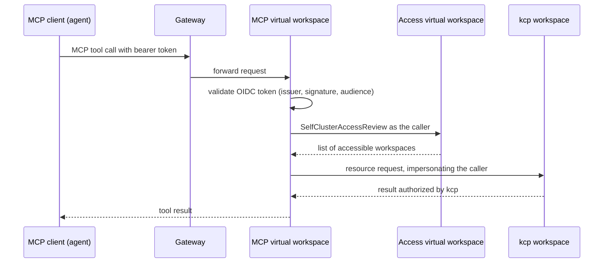

# MCP integration

The MCP integration lets AI agents work with Platform Mesh resources through the [Model Context Protocol](https://modelcontextprotocol.io). An agent connects to an MCP server that understands kcp workspaces and always acts as the signed-in user. The agent sees only the workspaces its user can access and every action runs with that user's permissions.

::: warning
The MCP integration is in alpha. It is an optional add-on, not part of the default Platform Mesh profile. APIs, chart values, and deployment wiring may change on short notice.
:::

## Why a dedicated MCP server

Generic Kubernetes MCP servers assume one cluster and one kubeconfig. Platform Mesh is neither: users work across many kcp workspaces, each with its own bound APIs, and authorization is evaluated per user, not per service account. The MCP integration closes that gap:

| Capability | Generic Kubernetes MCP server | Platform Mesh MCP integration |
| --- | --- | --- |
| Workspaces | One cluster per kubeconfig context | Discovers the caller's workspaces and operates across them |
| Identity | Kubeconfig or service account credentials shared by all sessions | The caller's own OIDC identity, per request |
| Authorization | Whatever the kubeconfig allows | kcp authorizes every request as the caller |
| Bound APIs | Static discovery | Lists the APIs actually bound in each workspace |

## Components

The integration consists of two kcp virtual workspaces, packaged as optional Helm charts in [platform-mesh/helm-charts](https://github.com/platform-mesh/helm-charts) and built from [kcp-dev/contrib-virtual-workspaces](https://github.com/kcp-dev/contrib-virtual-workspaces):

- The **access virtual workspace** (`kcp-access-vw` chart) answers `SelfClusterAccessReview` requests. Given a caller's identity, it returns the kcp workspaces that caller can access.
- The **MCP virtual workspace** (`kcp-mcp-vw` chart) is the MCP server. At the start of each request it asks the access virtual workspace for the caller's workspaces and limits the whole session to that set. Every resource read and write impersonates the caller, so kcp and the [authorization webhook](/concepts/security/authorization.md) evaluate each request against the user's own permissions.

Both charts render [kcp-operator](/reference/components/kcp-operator.md) `VirtualWorkspace` resources, so the operator deploys and wires both endpoints declaratively.

## Request path

The MCP server validates the caller's bearer token itself. The token never travels further: every kcp-side call uses the MCP server's own client certificate through the kcp front-proxy, and the kcp API does not accept MCP tokens at all. A credential issued for the MCP endpoint is useless anywhere else, which is the token audience binding the [MCP authorization specification](https://modelcontextprotocol.io/specification/latest/basic/authorization) requires.

The MCP server is stateless. It rebuilds the session scope on every request, so a change to the user's access takes effect immediately instead of lasting for the lifetime of a session.

## Authorization model

Three properties follow from the design:

- **No shared credentials.** The MCP server holds no kubeconfig for user data access. It impersonates the caller, and kcp decides.
- **Scoping before access.** A workspace that the access virtual workspace does not return is not reachable through any tool. Requests for other workspaces fail with a scope error.
- **Defense in depth.** Even inside a scoped workspace, each request passes the regular kcp authorizer chain, including RBAC and the relationship-based [authorization webhook](/concepts/security/authorization.md).

## Exposure paths

Two ways to publish the MCP endpoint exist, and they differ in who handles the OAuth ceremony:

- **Direct.** The platform gateway routes the MCP host straight to the MCP server, which validates the caller's OIDC bearer token and serves OAuth protected resource metadata (RFC 9728), so MCP clients discover the identity provider, register, and open a browser login without manual configuration.
- **Behind an MCP-aware gateway.** A gateway such as the Agent Router validates the JWT — including the audience — serves the OAuth discovery metadata itself, and forwards the token to the MCP server, which re-validates it independently. This path suits deployments that already run a gateway at the edge, and it is where aggregation of additional MCP backends, for example a search backend, can happen later.

## Toolsets

The MCP server groups its tools into toolsets that the chart enables explicitly. The `core` toolset covers workspace discovery, API bindings, and resource reads. The `apis`, `write`, and `admin` toolsets are opt-in, so a deployment exposes write access or platform internals only when the operator decides to.

## Related

- [Deploy the MCP integration](/how-to-guides/deploy-mcp-integration.md)
- [Troubleshoot the MCP integration](/how-to-guides/troubleshoot-mcp-integration.md)
- [Work with your workspaces through an MCP agent](/tutorials/work-with-workspaces-mcp.md)
- [Identity and authorization](/concepts/identity-and-authorization.md)
- [Security architecture](/concepts/security/index.md)
- [kcp virtual workspaces](/reference/components/kcp/virtual-workspaces.md)
